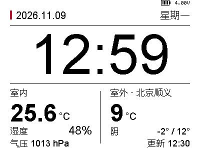
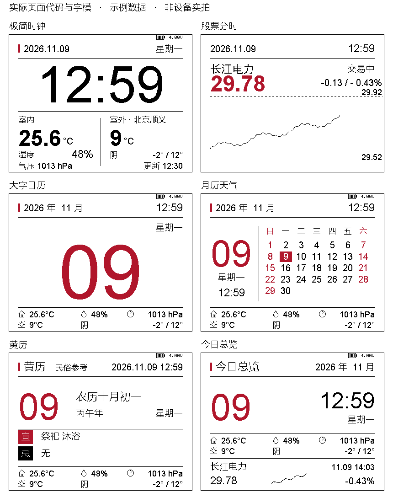

# epaper-dashboard · 横屏墨水屏看板

ESP32-S3 + 4.2 寸黑白红墨水屏，独立采集室内温湿度与气压，通过 Wi-Fi 显示时间、和风天气、日历和 A 股分时行情。交易时段自动看股票，其余时间轮播生活卡片，也可以在网页上固定页面。

当前设备固件：**v0.5.19**，保留已认可的极简时钟，其他日常卡片以图标精简环境栏；股票页 header 只保留日期和时间。2026-11-14 已校验烧录，AHT20/BMP280 实测有效，新版实屏观感待用户确认。保留 **2.5 MiB 单 factory 应用、无 OTA** 分区及原配置。详见[布局与设备验证](docs/validation.md#2026-11-14-v0519-图标环境栏烧录验证)。

历史已烧录固件：**v0.5.16**，电池图标按补偿后的电压显示 1～4 格，USB 供电显示闪电，保留顶部 y=0..10 的位置；2026-11-11 已校验烧录，尚未发布，实屏格数待用户确认。

v0.5.16 本地验证：四档边界、四个槽位逐像素填充、USB 闪电/未知读数、电压文字相同但格数变化时的刷新，以及七页边界/重叠/局刷、4567 字形、市场与休眠边界检查通过。程序段 1,309,329 字节，应用二进制 1,309,568 字节，原分区剩余 1,152 字节；构建、哈希及检查日志已保留到主工作树 `build/battery-0.5.16/`，模拟预览在 `build/battery-preview-0.5.16/`。2026-11-11 经 `/dev/cu.usbmodem11101` 上传并通过哈希校验，串口和认证 API 确认版本 0.5.16，全刷 20,927ms、后续局刷约 941ms，无显示/电源错误。串口关闭后 loopCount 1,638→2,556、screenCheckCount 39→59，运行持续推进，临时配置窗口已关闭。运行日志和状态证据同样保留在 `build/battery-0.5.16/`；实际电池格数观感与电量准确度待用户实物确认。

v0.5.15 验证：编译及七页边界/重叠/局刷检查通过，应用二进制 1,309,360 字节，保留原分区与配置。串口及认证 API 确认版本 0.5.15，全刷 20,927ms、局刷约 944ms，无显示/电源错误；串口关闭后 loopCount 1,082→1,909、screenCheckCount 27→47，配置窗口已关闭。固件、哈希及运行证据保留在主工作树被忽略的 `build/status-0.5.15/`，清理功能 worktree 不会删除这些产物。

当前版本：**[v0.5.11](https://github.com/985860612/epaper-dashboard/releases/tag/v0.5.11)** · [固件与校验记录](firmware/releases/0.5.11-2026-11-10/) · [字体与版式](docs/typography.md)

开发版本：**v0.5.12**，加入 GPIO3 供电电压与电池/充电图标，2026-11-10 已校验烧录，尚未发布。见[设备验证](docs/validation.md#2026-11-10-v0512-电压与电池图标)。

已烧录版本：**v0.5.13**，按用户反馈的 0.50V 差值增加电池供电显示补偿，2026-11-11 已校验烧录，尚未发布。

开发版本：**v0.5.14**，修正股票页两个价格刻度挤在右下角的问题；最高价刻度固定在绘图区右上方，最低价刻度固定在右下方，文字放在曲线区域外，保留曲线宽度。2026-11-11 已校验烧录，尚未发布；实屏效果待用户确认。

v0.5.14 本地验证：按用户照片中的价格区间构造模拟样本，覆盖昨收接近低点、中间和高点，以及曲线到达最右侧的情况；两项价格文字分别位于绘图区上方、下方，右对齐且不覆盖曲线。4567 字形、七页边界/重叠/局刷、36 个月份、极端输入、电压补偿、市场与休眠边界和网页分色检查通过。程序段 1,309,113 字节，应用二进制 1,309,360 字节，原分区剩余 1,360 字节；构建与模拟预览已保留在主工作树 `build/axis-0.5.14/` 和 `build/axis-preview-0.5.14/`。模拟样本不代表真实行情或设备实拍。2026-11-11 经 `/dev/cu.usbmodem11101` 上传并通过哈希校验，串口和认证 API 确认版本 0.5.14；股票页全刷 20,924ms、红色局刷 18,585ms、黑白局刷约 955ms，均无显示/电源错误。串口关闭后 loopCount 1,634→2,145、screenCheckCount 41→54，长局刷期间计数暂停符合预期，完成后持续推进；配置窗口已关闭。运行证据保留在 `build/axis-0.5.14/` 的 `runtime-serial.log`、`status-initial.json` 和 `status-monitor-closed.json`，实屏效果待用户确认。

## 界面预览

下面的图片由固件使用的页面代码和字模生成，展示的是**示例数据**，不是设备实拍或实时行情。

<table>
<tr><th>股票分时</th><th>极简时钟与天气</th></tr>
<tr><td></td><td></td></tr>
</table>

股票页保留大号现价、涨跌金额与涨跌幅。价格线高于昨收画红色，低于或等于昨收画黑色；穿越昨收时在交点分段。刻度只留价格数字，去掉均价线，减少干扰。

<details>
<summary>查看六套页面：五张日常卡片 + 股票分时</summary>



</details>

## 能做什么

- **自动切换**：交易日从 09:15 集合竞价开始显示股票；正式分时线从 09:30 绘制，午休压缩为连续时间轴。非交易时间默认每 10 分钟轮换卡片。
- **五张日常卡片**：大字日历、月历天气、黄历、极简时钟、今日总览。网页支持固定卡片和手动切换。
- **自选股**：支持最多 8 只沪深股票，默认长江电力 `sh600900`；显示当前价、涨跌和当日价格分时线。
- **和风天气**：可配置 API Host、Key 与城市/区县位置，默认北京顺义；天气按 30 分钟调度更新。
- **独立校时**：使用阿里云 NTP，联网后首次同步，此后每小时校准，北京时间运行。
- **网页配置**：管理 Wi-Fi、城市、股票、交易日历、轮播和刷新模式；密码与 Key 不通过配置查询接口回显。
- **按需联网与局刷**：轻睡眠保留前帧，每分钟唤醒；平时网页离线，短按 BOOT 开启 10 分钟配置窗口。

## 硬件与接线

已验证组合：**ESP32-S3 Mini + HINK-E042A13 4.2 寸 400×300 黑白红屏**。

| 墨水屏驱动板 | ESP32-S3 |
| --- | --- |
| GND | GND |
| 3V3 | 3V3 |
| SCK | GPIO12 |
| SDA / DIN / MOSI | GPIO11 |
| CS | GPIO10 |
| DC | GPIO13 |
| RST | GPIO7 |
| BUSY | GPIO4 |
| CS2 | 不接 |

SPI 4MHz，BUSY 高电平表示忙，等待上限 90 秒。供电和逻辑电平使用 3.3V。

### 室内温湿度与气压（v0.5.19）

AHT20 与 BMP280 共用 I²C，总线固定为 100 kHz：

| 模块引脚 | ESP32-S3 |
| --- | --- |
| VCC / VIN | 3V3 |
| GND | GND |
| SDA | GPIO6 |
| SCL | GPIO5 |

墨水屏自身的 SDA/DIN 仍接 GPIO11，它是 SPI 数据线，与上述传感器 SDA 不同。

温度和湿度来自 AHT20，气压来自 BMP280，为当地绝对气压，未换算到海平面。室内传感器与和风室外天气明确分开，生活卡片保留右上角电池。v0.5.19 的页面布局：

| 页面 | 环境信息布局 |
| --- | --- |
| 极简时钟／等待校时 | 大时钟下方并列室内、室外两栏；左栏大号温度、湿度和气压，右栏城市、温度、天气、温度范围及天气观测时刻 |
| 大字日历／月历天气／黄历 | 底部两行：房屋、湿度、气压图标配室内数值；室外图标配温度、天气和当日范围，去掉重复城市名与文字标签 |
| 今日总览 | 中间两行环境区，底部继续显示行情摘要 |
| 股票分时 | 页眉仅保留完整日期与时间；不显示环境读数或电池，分时曲线和价格刻度保持原区域 |

不再使用顶部的微型 `IN` 状态行。时钟页的室内、室外区域独立局刷；其他生活卡片复用各自环境栏，更新只使用黑色。传感器未就绪显示 `--`；天气过期/请求失败保留明确“缓存”字样，时钟页的更新时间取天气观测时刻，不冒充本机最新采样。

- 开机采样；时间有效时每个自然分钟采样一次，未校时时按单调时钟每 60 秒采样。沿用原有唤醒调度，不为传感器额外唤醒。采样先于本轮联网请求。
- AHT20 使用 `0x38`，核验校准状态和 CRC；BMP280 检查 `0x76`、`0x77` 的芯片 ID，仅接受 `0x58`，以温压各 ×1 的强制模式采样后回到休眠。未将其他芯片默认为 BMP280。
- 两颗传感器独立报告状态。未连接、读取错误、CRC 错误、忙超时或非法数据时，相应字段显示 `--`；下一分钟自动重试，不用旧值伪装当前值。
- I²C 单次事务超时为 20 ms，测量等待有固定上限；正常采集等待约 90 ms，不在长循环中无限等待。
- 串口 `status` 和认证后的 `/api/status` 增加 `environment`：`ahtValid`、`bmpValid`、`temperature`（°C）、`humidity`（%RH）、`pressureHpa`、`ahtError`、`bmpError`、`bmpAddress`（十进制）、`attempts`、`sampleAgeMs`。无效数值为 JSON `null`。
- 显示温度保留一位小数，湿度和气压取整数；仅显示值变化时刷新对应环境区域。整屏模式仍遵守原有 120 秒节流。

协议与补偿依据：[AHT20 手册 §5.4](https://files.seeedstudio.com/wiki/Grove-AHT20_I2C_Industrial_Grade_Temperature_and_Humidity_Sensor/AHT20-datasheet-2020-4-16.pdf)、[Bosch BMP280 手册 rev 1.26 §4、§8.1](https://www.bosch-sensortec.com/media/boschsensortec/downloads/datasheets/bst-bmp280-ds001.pdf)。传感器测试覆盖官方气压参考向量、CRC、校准、地址/芯片识别、读写失败、忙超时、断连恢复与计时回绕；七页预览检查状态区无覆盖、无红色变化，并落在局刷范围内。

### 电压与电池图标

v0.5.16 增加格数显示，使用补偿后的电压作粗略分档：低于 3.6V 为 1 格，3.6V 至不足 3.8V 为 2 格，3.8V 至不足 4.0V 为 3 格，4.0V 及以上为 4 格。格数仅表示界面定义的电压档位，没有对当前电池的放电曲线做容量标定，不等同于精确百分比。USB 供电继续只显示闪电，异常读数显示空框和 `-.--V`；补偿与原始 4.5V 判断保持原逻辑。格数变化单独纳入刷新标识，即使四舍五入后的电压文字相同，也会更新图标。

Nologo ESP32-S3 SuperMini 的 GPIO3 已通过两个 100kΩ 电阻连接 VBUS 分压，固件用校准 ADC 毫伏值乘 2 还原供电电压，取 16 次采样、剔除最大最小值后平均。屏幕右上方显示电池图标与电压；**未补偿的还原电压大于 4.5V** 时，电池图标内显示闪电，4.5V 及以下显示普通电池图标。异常读数显示 `-.--V`，不显示电量百分比。

v0.5.13 在有效读数且未补偿电压 ≤4.5V 时，显示电压 = GPIO3 采样电压 × 2 + **0.50V**；例如原显示 3.50V 改为 4.00V。超过 4.5V 的外部供电读数原样显示，不加补偿；无效读数也不补偿。补偿值集中在 `battery.h` 的 `BATTERY_DIODE_DROP_MV`，图标判断始终使用原始还原电压，补偿后超过 4.5V 不会误判为充电。

0.50V 来自用户在 2026-11-11 反馈的当前差值，用于估算电池端电压；没有电流和温度采样，固定补偿不等同于多点校准或动态二极管模型。[BAT60B 手册](https://www.infineon.com/assets/row/public/documents/24/49/infineon-bat60bseries-ds-en.pdf)说明压降随负载变化。插 USB 时显示的是外部供电电压，闪电表示外接电源，不能据此判断电池正在充电或已经充满。硬件依据：[Nologo 厂家原理图](https://www.nologo.tech/assets/img/esp32/esp32s3supermini/1.png)。其他同名板须先核对 GPIO3 分压线路。

v0.5.13 本地验证：补偿值、USB 不补偿、原始 4.5V 判断、无效读数、图标切换，以及行情/时间/休眠边界和七页绘制检查通过。程序段 1,309,369 字节，应用二进制 1,309,616 字节，原分区剩余 1,104 字节；SHA-256 为 `9b5645dbed47dfc1ad7df71e604dcd0e9d572f9f21cee1561e2e6851f09b4384`。首次上传未收到串口数据、尚未开始写入；提示 BOOT/RESET 后用户要求继续，重试上传哈希验证通过。串口及认证 API 均确认版本 0.5.13，全刷 20,940ms、后续局刷 943ms，BUSY 正常，无显示/电源错误，天气和 242 点行情有效。关闭串口后三次 API 核验，loopCount 1,527→1,984→2,378、screenCheckCount 36→46→56，均无显示/电源错误；临时配置窗口已关闭，恢复原省电调度。本次已烧录固件、日志与状态证据已保留到主工作树的 `build/battery-0.5.13/`，预览在 `build/battery-preview-0.5.13/`，清理功能 worktree 不会删除这些产物。绝对电压准确度仍待用户实测反馈，上传和运行验证不代替电池端电压标定。

采样间隔至少 10 秒，沿用现有唤醒与屏幕检查调度，不为采样额外唤醒；休眠时通常随每分钟唤醒更新。状态变化纳入黑白局刷区域，整屏模式仍遵守原有 120 秒节流。此功能只显示状态，不提供过放断电保护。

采集使用 ESP-IDF ADC1 通道 2 的单次转换及芯片校准；初始化或读取失败会记录串口错误并显示未知。为维持原应用分区，行情行解析改为逐字段转换，保留时间、价格、成交量和成交额及原精度，不再引入通用浮点 `sscanf` 引擎。

v0.5.12 本地验证：电压与严格 4.5V 边界、行情解析、交易时间、卡片、休眠调度、红色转换和七种页面绘制检查通过，确认状态区不覆盖原页面且变化落在局刷范围内。程序段 1,309,201 字节，应用二进制 1,309,440 字节，原分区剩余 1,280 字节；沿用原 `-Os`、C++/链接 LTO 和分区配置。已完成校验烧录、设备版本和全刷/局刷运行核验；电压准确度、实屏图标及拔插 USB 切换仍待用户实物确认。

固件沿用 `GxEPD2_420c_GDEY042Z98` 兼容驱动及本项目验证过的波形；这不等于确认了实物的控制器型号。其他面板、尺寸或黑白版本不能直接套用本项目三色波形。

## 刷新与省电

| 项目 | 当前行为 |
| --- | --- |
| 卡片轮换 | 非交易时间每 600 秒，支持固定页面 |
| 时间 | 按分钟更新，局刷窗口独立于天气区 |
| 行情 | 网页可配置；已验证的设备配置为每 60 秒抓取 |
| 天气 | 每 30 分钟调度更新 |
| 校时 | 阿里云 NTP，每小时校准 |
| 维护全刷 | 股票页每 10 分钟，其他页面约 15 分钟 |
| 配置窗口 | 启动 90 秒；短按 BOOT 开启 10 分钟 |

本块面板的黑白窗口局刷约 1 秒，部分股票黑白更新约 2 秒；红色局刷约 18–19 秒，整屏刷新约 21 秒。**三色局刷不等于快速 LCD 刷新**，耗时和残影需以实屏确认。

首次使用默认采用保守的整屏刷新，间隔 120 秒；若使用本项目已验证的同一屏幕，可在网页中启用局刷、选择刷新模式并将行情间隔设为 60 秒。已有 NVS 配置不会因更新固件而重置。

当前采用 CPU 80MHz、Wi-Fi 最大调制解调器省电及每分钟手动 Light-sleep。整机电流受开发板、稳压器、指示灯和驱动板影响；仓库没有将软件休眠计数换算成电池续航承诺。详见[省电与 BOOT 配置窗口](docs/minute-sleep.md)。

## 编译与烧录

### 1. 准备环境

需要 Arduino CLI、`uv` 和数据线。使用项目构建脚本，以应用自定义分区及正确容量上限。已验证依赖：

| 依赖 | 版本 |
| --- | --- |
| ESP32 Arduino Core | 3.3.11 |
| GxEPD2 | 1.6.9 |
| ArduinoJson | 7.4.3 |
| Adafruit GFX Library | 1.13.0 |
| Adafruit BusIO | 1.17.4 |

```sh
git clone https://github.com/985860612/epaper-dashboard.git
cd epaper-dashboard

arduino-cli core update-index --additional-urls https://espressif.github.io/arduino-esp32/package_esp32_index.json
arduino-cli core install esp32:esp32@3.3.11 --additional-urls https://espressif.github.io/arduino-esp32/package_esp32_index.json
arduino-cli lib install "GxEPD2@1.6.9" "ArduinoJson@7.4.3" "Adafruit GFX Library@1.13.0" "Adafruit BusIO@1.17.4"
```

### 2. 编译

```sh
uv run tools/build_firmware.py --build-path "$PWD/build/release"
```

构建器使用 `esp32:esp32:esp32s3:CDCOnBoot=cdc`，仅对 C++ 与链接启用 LTO，PSRAM 关闭，使用 4MB Flash 下的项目自定义单应用分区：`factory` 从 `0x10000` 开始，大小 `0x280000`（2.5 MiB），不保留 OTA 应用槽或 OTA 数据分区。NVS（`0x9000`）、SPIFFS（`0x290000`）和 coredump（`0x3f0000`）保持原位置及大小。构建器从 `partitions.csv` 校验布局并设置容量上限。已生成的字模和网页 gzip 头包含在源码中，**直接编译不需要安装原始字体**。

v0.5.19 程序段为 **1,315,505 字节**，应用二进制 **1,315,744 字节**，单应用分区上限 **2,621,440 字节**，剩余 **1,305,696 字节**。原 v0.5.11 使用的应用分区上限为 1,310,720 字节；修改后应重新检查容量。[当前版本验证与 SHA-256](docs/validation.md#2026-11-14-v0519-图标环境栏烧录验证)。

### 3. 上传并校验

先用 `arduino-cli board list` 确认当前端口，再替换示例端口：

```sh
arduino-cli upload \
  --fqbn esp32:esp32:esp32s3:CDCOnBoot=cdc \
  --port /dev/cu.usbmodemXXXX \
  --build-path "$PWD/build/release" \
  --verify \
  firmware/epaper_dashboard
```

Windows 可使用对应的 `COM` 端口。v0.5.17 首次升级会写入上述单应用分区表，同时保留 NVS 和数据分区。先备份 Flash；不要整片擦除。后续使用同一分区表更新。无 OTA，更新通过 USB 完成。串口波特率 115200，正常运行不需要电脑或串口监视器常驻。

本次原生 USB 在 stub 模式长读 Flash 时发生断流，使用 ROM 模式 `--no-stub` 完成备份和上传。上传命令可追加 `--upload-property upload.flags=--no-stub --upload-property upload.speed=115200`。

也可以从 [GitHub Releases](https://github.com/985860612/epaper-dashboard/releases) 下载已验证的固件包，具体偏移以包内 `flash_args` 为准，不要只凭文件名猜写入地址。

## 配网与网页管理

首次未配网或无法联网时，设备会显示设置页并开启 `EPaper-...` 热点；连接信息和临时管理密码在屏幕上显示。连接后访问 `http://192.168.4.1/`，用户名为 `admin`。

配置自己的 Wi-Fi、和风专属 API Host/Key 和天气位置后，设备连接局域网。短按 BOOT 开启配置窗口，再访问设备 IP，即可修改股票列表、城市、刷新模式及卡片。网页有“保持配置 10 分钟”和“立即省电”；休眠期间无法访问网页属于正常行为。

股票使用 `sh600900`、`sz000001` 这样的市场前缀代码。和风天气位置采用区县 LocationID，支持网页搜索。密码与 Key 留空表示保留原值，不会清空。

如已有本机私有配置，也可通过 USB 导入：

```sh
uv run tools/provision.py \
  --port /dev/cu.usbmodemXXXX \
  --source /path/to/private/qweather.env \
  --wifi "$PWD/local/wifi.json"
```

`local/wifi.json` 使用 `ssid`、`wifiPassword` 两个字段；`qweather.env` 使用 `QWEATHER_API_HOST`、`QWEATHER_API_KEY`。导入脚本生成的登录资料存放于 `local/device-access.json`，权限为 0600。`local/` 与 `build/` 已忽略，固件不内置个人网络、和风 Key 或固定管理密码。

## 字体与二次开发

- 中文默认方正晶细黑；当前股票名称“长江电力”使用苹方简体 Regular 24px。
- 英文/数字默认 Arial Regular，主现价使用 Arial Bold 48px；价格刻度为原生 18px Regular。
- 文字按原生字号生成 1-bit 字模，不拉伸、不用网点模拟文字灰阶。未验证本面板原生灰度。
- 名称子集未包含的汉字会整段回退到已有的 18px 基础字库；长文本按像素省略。添加新的股票名称时，可按需扩充子集。

唯一字体规格为 [`tools/typography.json`](tools/typography.json)。重建字模需自行准备规格中对应的本机字体：

```sh
uv run tools/build_fonts.py
uv run tools/check_typography.py
```

`check_typography.py` 从实际 C++ 页面头与字模渲染预览，检查字形、间距、重叠、边界和局刷覆盖。预览图输出到被忽略的 `build/`。

字体文件及其授权相互独立：仓库中的开放字体附有对应许可证，系统字体与本地专有原字体不随源码 ZIP 分发。详见[字体说明](assets/fonts/README.md)、[字体来源元数据](assets/fonts/)和[字体规划](docs/typography.md)。

## 数据与已知边界

- 行情来自现有网络接口，可能延迟或不可用；历史/过期数据会标记状态，不作为交易依据。
- 交易日历仅预置 **2026 年**；跨年须在网页更新，未更新时自动模式显示时间天气并提示，不用工作日近似交易日。
- 黄历数据覆盖 **2026–2028 年**，离线生成，宜忌仅作民俗参考。
- 红色局刷速度、残影和驱动兼容性仍是实验结果，不代表同型号所有批次均有相同表现。
- 管理网页面向可信局域网，没有提供公网部署方案。

## 项目目录与记录

| 位置 | 内容 |
| --- | --- |
| [`firmware/epaper_dashboard/`](firmware/epaper_dashboard/) | 当前 Arduino 固件与嵌入式管理网页 |
| [`firmware/releases/`](firmware/releases/) | 已烧录版本、源码快照、校验和与验证记录 |
| [`tools/`](tools/) | 编译、字模生成、预览检查、配网与黄历数据工具 |
| [`tests/`](tests/) | 交易时间、卡片、功耗调度、字形与分色检查 |
| [`docs/validation/`](docs/validation/) | 实验与设备验证记录 |
| [`docs/images/`](docs/images/) | 本页的当前界面配图 |
| [`experiments/`](experiments/) | 历史研究与实验脚本 |
| [`licenses/`](licenses/) | EPaperDrive、黄历数据工具等第三方许可证 |

更多资料：[设计与数据规则](docs/design.md) · [局刷研究](docs/partial-refresh.md) · [GitHub 发布前开发记录](docs/development-history.md)。
